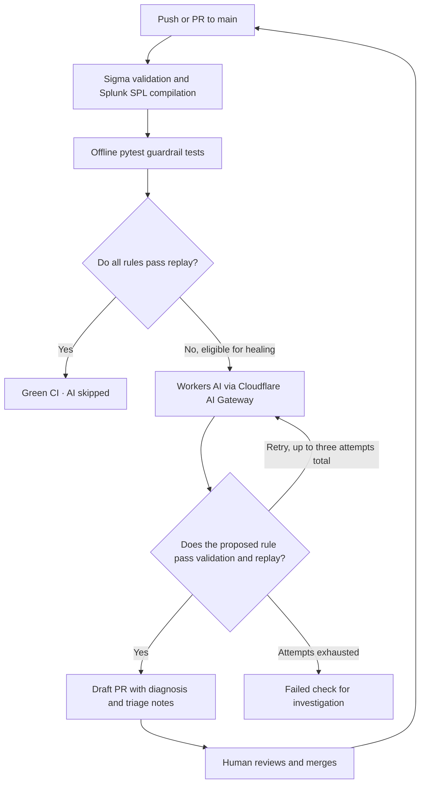

# DriftGuard

[](https://github.com/sfazliddinov385/DriftGuard/actions/workflows/replay-validation.yml)

**DriftGuard catches broken Windows detections before an analyst has to rely on them.** On each push or pull request to `main`, GitHub Actions validates the Sigma rules, compiles them to Splunk SPL, tests the healer, and replays recorded Sysmon events. A healthy run needs no AI credentials to do this work. The recordings are read as data, so the suite runs locally without a VM or a live SIEM.

If replay finds a miss, Cloudflare Workers AI proposes a rule change through AI Gateway. A Python script checks the proposal against the same labeled events and additional examples withheld from the model. A passing proposal goes into a draft pull request for a person to review.

## Validation dashboard

The dashboard shows the result of the latest published validation of `main`. Expand a detection to inspect the event IDs, withheld positives, and benign alerts. The workflow publishes failed checks as well as passes, and links the report to the tested commit and Actions run. [Open dashboard](https://sfazliddinov385.github.io/DriftGuard/) · [Download the results as JSON](https://sfazliddinov385.github.io/DriftGuard/data.json)

The original Sysmon recordings are XML, the rules and fixture labels are YAML, and the field allowlist and the healer’s structured model replies are JSON. The public report contains counts, event record IDs, and check outcomes. To generate a replay report locally, run `python scripts/run_replay_suite.py --json-out reports/replay.json`.

## Architecture



A failed replay keeps the original commit red even if the healer opens a draft PR. GitHub evaluates the repair again on its own commit. The workflow skips the healer on its own repair branches. [Workflow](.github/workflows/replay-validation.yml)

## MITRE ATT&CK detection coverage

All three rules use Windows process-creation events (Sysmon Event ID 1). The replay checks **which recorded event IDs matched**, so a false alert cannot make up for a missed event. Each rule also has two withheld positive cases and four synthetic benign examples. The results below come from [GitHub Actions run #18](https://github.com/sfazliddinov385/DriftGuard/actions/runs/45932868128/job/140289266826).

| Sigma rule | ATT&CK | What it detects | Splunk recording · expected matches | Withheld hits | Benign alerts |
| --- | --- | --- | --- | ---: | ---: |
| [Encoded PowerShell](rules/windows/proc_creation_encoded_powershell.yml) | `T1059.001` | Windows PowerShell or `pwsh` launched with an encoded-command switch | [2 of 4](tests/fixtures/encoded_powershell/splunk-sysmon.log) | 2/2 | 0/4 |
| [Suspicious scheduled task](rules/windows/proc_creation_schtasks_suspicious.yml) | `T1053.005` | `schtasks.exe` creating a task that references a script interpreter, URL, or one of the rule’s suspicious paths | [2 of 16](tests/fixtures/scheduled_task/splunk-sysmon.log) | 2/2 | 0/4 |
| [Suspicious Mshta](rules/windows/proc_creation_mshta_suspicious.yml) | `T1218.005` | `mshta.exe` with an inline script protocol, remote URL, or one of the rule’s suspicious local paths | [6 of 10](tests/fixtures/mshta_execution/splunk-sysmon.log) | 2/2 | 0/4 |

The fixture counts apply to these recordings. SPL compilation checks that the backend can translate each rule. Testing alert delivery or ingestion latency would require a connected Splunk instance. [Replay manifest and labels](tests/manifest.yml) · [Splunk Attack Data](https://github.com/splunk/attack_data)

## Healer guardrails

- **Healthy runs skip inference.** Run #18 passed all four checks and skipped both the Cloudflare call and draft PR creation. [Run details](https://github.com/sfazliddinov385/DriftGuard/actions/runs/45932868128)
- **Telemetry sent to the gateway is limited.** The healer selects allowlisted fields from up to ten recorded events, truncates field values, and masks recognized IPv4 addresses, email addresses, `User=…` strings, and brace-delimited GUIDs. The prompt also includes the broken rule and the manifest’s benign examples. [Healer](scripts/ai_healer.py) · [Sysmon field allowlist](schemas/sysmon_field_allowlist.json)
- **Proposed fixes must pass local checks.** Pydantic validates the model response. The referee checks candidate selection fields, runs `sigma check`, and uses native pySigma matching on the recording, withheld positives, and benign cases. Only a candidate that passes is eligible for a draft PR. [Replay implementation](scripts/run_replay_suite.py)
- **The safeguards have their own offline tests.** Five pytest cases exercise redaction, unknown-field rejection, overfitting, truncated model output, and the JSON fallback path. [Guardrail tests](tests/test_ai_healer.py)

## What broke during development

**The model stopped halfway through a rule.** Three incomplete replies failed JSON validation. Both response formats now request up to 2,048 output tokens, and the healer detects a length cutoff before parsing. The next live test received a complete reply on its first attempt and opened a draft PR. [PR #1](https://github.com/sfazliddinov385/DriftGuard/pull/1) · [Live recovery run](https://github.com/sfazliddinov385/DriftGuard/actions/runs/45928153470/job/140274290861)

**The first repair passed the recording but missed valid PowerShell events.** Both recorded positives happened to include `-ep`, so the AI made that unrelated switch mandatory. Two withheld cases now exercise encoded commands without `-ep`. They reject the original proposal and pass the corrected rule. [PR #2](https://github.com/sfazliddinov385/DriftGuard/pull/2) · [Post-merge replay](https://github.com/sfazliddinov385/DriftGuard/actions/runs/45930785847)

## Local quickstart

Clone the repository, open its root directory, and use Python 3.11 to match CI. All four checks run locally with the committed fixtures. Only the live healer uses Cloudflare credentials.

**Windows PowerShell**

```powershell
python -m venv .venv
.\.venv\Scripts\python.exe -m pip install -r requirements.txt
.\.venv\Scripts\sigma.exe check --fail-on-issues rules/
.\.venv\Scripts\sigma.exe convert -t splunk -p splunk_windows rules/
.\.venv\Scripts\python.exe -m pytest -q
.\.venv\Scripts\python.exe scripts/run_replay_suite.py
```

**macOS or Linux**

```bash
python3 -m venv .venv
source .venv/bin/activate
python -m pip install -r requirements.txt
sigma check --fail-on-issues rules/
sigma convert -t splunk -p splunk_windows rules/
python -m pytest -q
python scripts/run_replay_suite.py
```

The final line should read `Suite summary: 3/3 rules passed.` To exercise the live recovery workflow in your own repository, configure the Actions secrets `CLOUDFLARE_ACCOUNT_ID`, `CLOUDFLARE_GATEWAY_ID`, and `CLOUDFLARE_API_TOKEN` and allow Actions to create pull requests.
