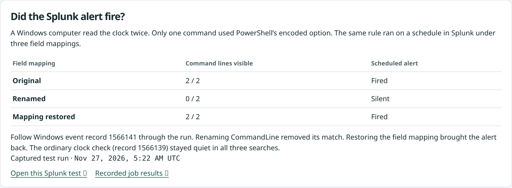
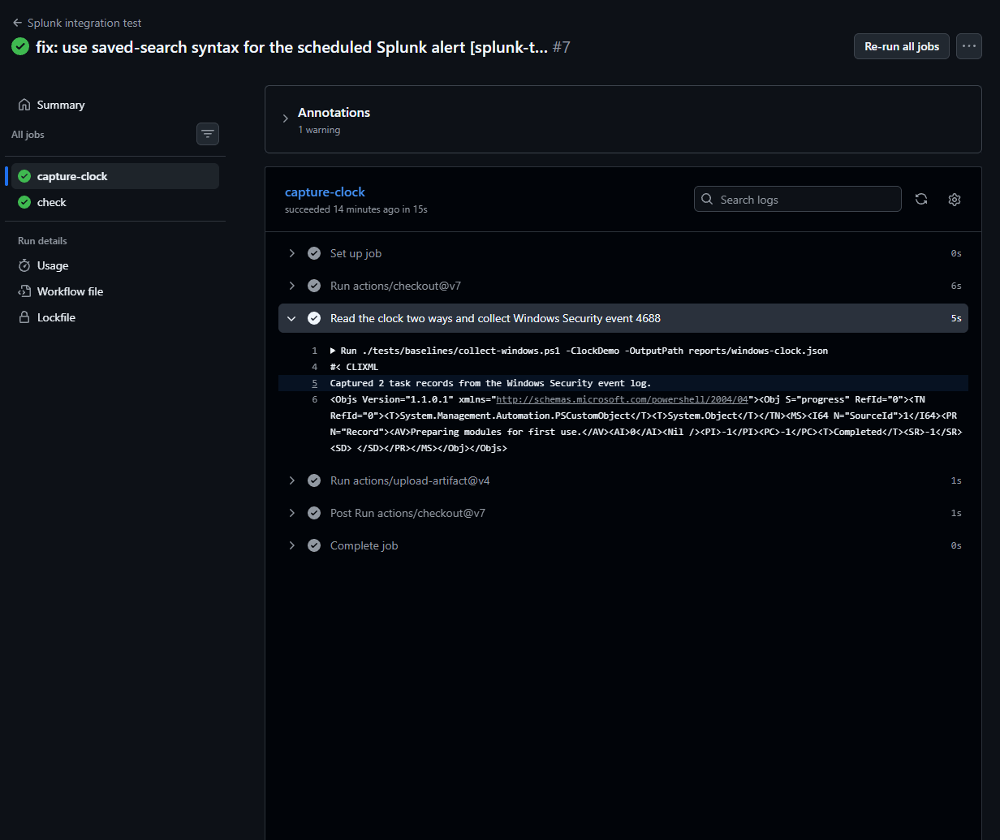
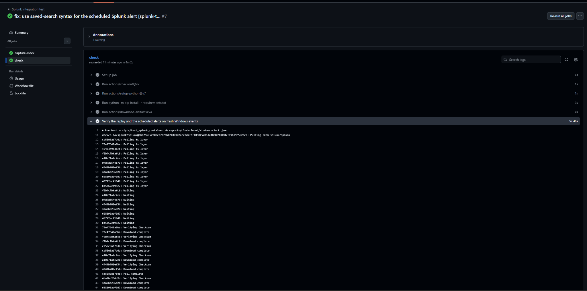
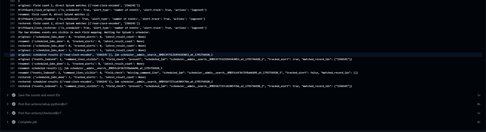
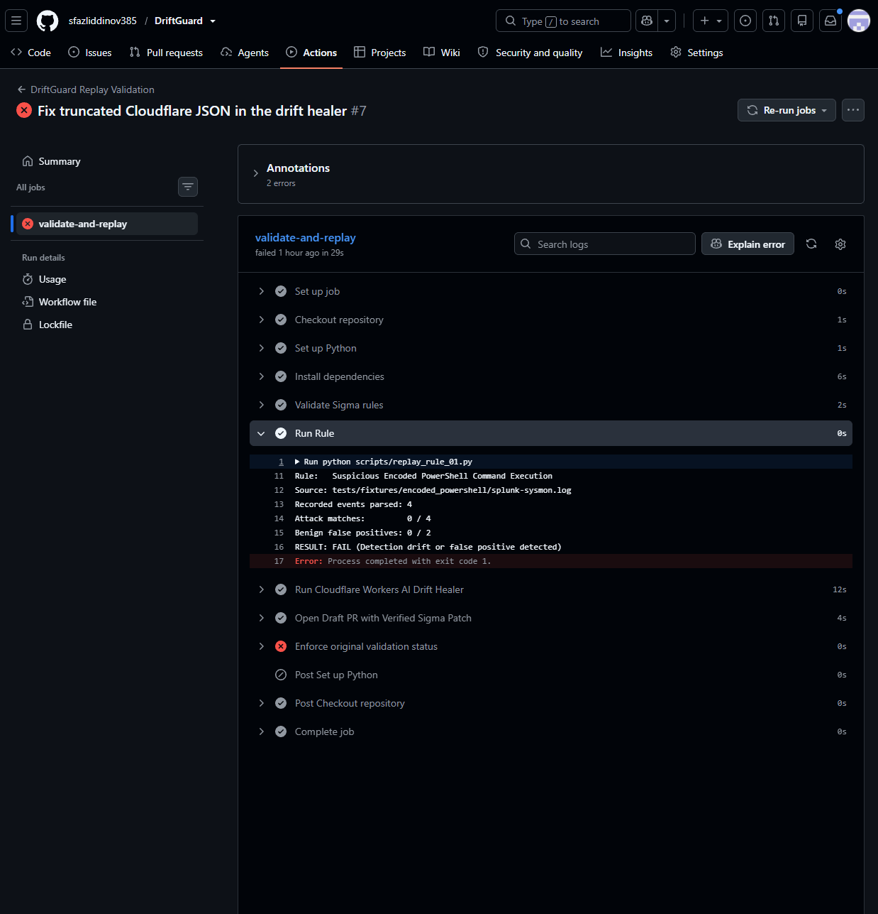

# DriftGuard

[](https://github.com/sfazliddinov385/DriftGuard/actions/workflows/replay-validation.yml)

**Does our alert rule still catch the right events after this edit?** DriftGuard helps a security team answer that question before it puts a rule into use.

When someone changes a rule on GitHub, DriftGuard runs it against saved Windows logs and checks exactly which events it finds. You can also run two read-only checks from a computer with access to Splunk. One tests the actual Splunk search. The other checks whether recent Windows logs still contain the fields the rule needs. Results from your local Splunk stay on that computer.

[See the latest test results](https://sfazliddinov385.github.io/DriftGuard/) · [View the checks on GitHub](https://github.com/sfazliddinov385/DriftGuard/actions/workflows/replay-validation.yml)

[Nightly Splunk check, Windows setup and Slack delivery](docs/operations.md) · [ATT&CK replay heatmap](https://mitre-attack.github.io/attack-navigator/#layerURL=https%3A%2F%2Fsfazliddinov385.github.io%2FDriftGuard%2Fattack-layer.json)

## How we proved the original alert recovered

Two Windows events reached Splunk, but its scheduled PowerShell alert missed the encoded command. The log source had moved the command text from `CommandLine` to `OriginalCommandText`. Both commands in this test simply read the clock. [See the missed alert](https://github.com/sfazliddinov385/DriftGuard/actions/runs/45948322930/job/140338174152)

| Stage | What Splunk recorded |
| --- | --- |
| Before the repair | The original alert ran and found neither event. It missed encoded record `1566191`. |
| During review | A separate scheduled search tried reading either field. It fired only on `1566191`. DriftGuard opened [PR #5](https://github.com/sfazliddinov385/DriftGuard/pull/5) with that evidence. |
| After merge | At **1:39 a.m. Central on November 27, 2026**, Splunk recorded the original alert firing on fresh encoded record **`1565734`**. The ordinary clock read, **`1565732`**, stayed quiet. [Open the scheduled run](https://github.com/sfazliddinov385/DriftGuard/actions/runs/45959485944/job/140373777332) |

The merge started a fresh hosted Splunk Enterprise instance. DriftGuard deployed the reviewed mapping under the original saved-search name, `DriftGuard_Managed_PowerShell_Canary`. Splunk's own scheduler ran it. DriftGuard verified the same job ID in the search results and the fired-alert history. [Compare the two job reports](docs/evidence/splunk-recovery.json)

## Watch a real Splunk alert fire

On a fresh Windows machine, we asked PowerShell for the time twice. One command used the encoded option that our rule watches for. Windows wrote a process-start record for each. We sent those two records to Splunk and let its scheduler run the alert.

| What changed | What Splunk did |
| --- | --- |
| Windows supplied the expected command-line field. | The alert fired on the encoded clock check. The ordinary clock check stayed quiet. |
| We renamed the field. Both events still reached Splunk. | The scheduled search ran and found zero matches. DriftGuard showed that the rule could no longer see either command line. |
| We told Splunk how to read the new field name. | The alert fired again on the same Windows record. |

This is the problem DriftGuard helps a SOC catch. Logs can keep arriving while an alert quietly loses the information it needs. Both commands in this test were harmless. [See the three results on the dashboard](https://sfazliddinov385.github.io/DriftGuard/#scheduled-alert-demo) · [Open the Windows and Splunk jobs](https://github.com/sfazliddinov385/DriftGuard/actions/runs/45944956740) · [Repeat the demo](docs/splunk-integration.md)



### Evidence from the same run

These screenshots come from the same GitHub Actions run. Each link opens the corresponding lines in the job log.

**1. Windows recorded both clock checks.** Line 5 shows that the capture job collected two process-start records from the Windows Security log (event type 4688). [Open the Windows capture](https://github.com/sfazliddinov385/DriftGuard/actions/runs/45944956740/job/140327420538#step:3:5)



**2. GitHub downloaded the official Splunk image.** Line 11 shows Docker pulling from `splunk/splunk`. A few lines below the screenshot, the log identifies Splunk Enterprise 10.2.10 and confirms the server was ready to accept requests. [See the version and startup confirmation](https://github.com/sfazliddinov385/DriftGuard/actions/runs/45944956740/job/140327513619#step:6:66)



**3. The logs kept arriving while the alert went silent.** On line 165, Splunk fired on Windows record `1566141`. On line 168, both events had arrived, but the renamed field left the rule with zero visible command lines and no alert. On line 171, restoring the field mapping made the same rule fire again on the same record. [Open the three scheduler results](https://github.com/sfazliddinov385/DriftGuard/actions/runs/45944956740/job/140327513619#step:6:165)



## What happened when we broke a rule

### 1. The rule looked valid but missed both events

We deliberately changed the PowerShell rule to look for a made-up flag, `-legacy_broken_flag`. The rule still passed the Sigma syntax check. Then DriftGuard replayed four recorded Windows events. **Two contained an encoded PowerShell command. The edited rule found zero.** The run stayed red to show that this version of the rule had failed. [Open the failed replay in run #7](https://github.com/sfazliddinov385/DriftGuard/actions/runs/45928153470/job/140274290861#step:6:1)



### 2. DriftGuard opened a repair for review

Cloudflare Workers AI suggested a change, and DriftGuard opened draft pull request #2. The suggestion caught both recorded examples. But both happened to include an extra flag, `-ep`, and the suggested rule required it. During review, two new examples showed that the rule would still miss encoded commands without that flag. We corrected the rule, kept both examples as tests, and merged the repair. [Read pull request #2](https://github.com/sfazliddinov385/DriftGuard/pull/2)


### 3. The same four events showed the fix worked

In a later run, the repaired PowerShell rule found **exactly the two expected events out of four**. It also caught both examples without `-ep` and left all four normal examples alone. All three rules passed their tests, so DriftGuard skipped the AI repair step. [Open the replay results in run #20](https://github.com/sfazliddinov385/DriftGuard/actions/runs/45934920471/job/140295805099#step:8:1)


## What the rules look for

The recordings come from Splunk Attack Data. They are XML logs from Sysmon, a Windows tool that records which programs started and how they were launched. The test lists the exact event IDs each rule should find. Catching the wrong two events would fail even if the count looked right. [See the expected event IDs and extra examples](tests/manifest.yml) · [Browse the source dataset](https://github.com/splunk/attack_data)

| Rule | What it looks for | Expected matches in the recording | MITRE ATT&CK |
| --- | --- | --- | --- |
| [Encoded PowerShell](rules/windows/proc_creation_encoded_powershell.yml) | PowerShell starts with a flag such as `-enc` that tells it to read an encoded command. | 2 of 4 | T1059.001 |
| [Suspicious scheduled task](rules/windows/proc_creation_schtasks_suspicious.yml) | A new Windows task points to a script runner, a web address, or a location such as a temporary folder. | 2 of 16 | T1053.005 |
| [Suspicious Mshta use](rules/windows/proc_creation_mshta_suspicious.yml) | The Windows program `mshta.exe` opens a web address, runs a script directly, or loads a file from a location the rule watches. | 6 of 10 | T1218.005 |

## How a rule change gets checked

1. On a push to `main` or a pull request targeting it, GitHub Actions checks the rule files and translates them into Splunk searches. It also runs tests for the repair code.
2. DriftGuard compares the files in `rules/` with its list of tests. If a rule is missing a test entry, the run fails and names the rule. It then compares each rule’s matches with the expected event IDs. Each rule also has extra examples it should catch and examples of normal activity it should leave alone.
3. If a rule fails replay, the repair script can ask Cloudflare Workers AI for a change through AI Gateway. It sends selected log fields and masks details such as email addresses. It keeps the two extra examples out of the request and uses them to check the suggested fix.
4. Only the part of the rule that decides what to match can change. If a suggestion changes the rule ID, severity, or any other setting, DriftGuard rejects it. It checks the fields and syntax of an eligible suggestion, then repeats the replay. It allows up to three attempts. A passing suggestion goes into a draft pull request for a person to review. The original failed run stays red.

The dashboard shows the latest published check of `main`. Open a rule to see which recorded events it missed or flagged unexpectedly. You can also download those results as JSON. [Open the dashboard](https://sfazliddinov385.github.io/DriftGuard/) · [Get the JSON report](https://sfazliddinov385.github.io/DriftGuard/data.json) · [Read the workflow](.github/workflows/replay-validation.yml)

During development, an early Cloudflare reply stopped halfway through a rule. We gave it more room to finish and added a check that rejects an incomplete reply. [Read the change in PR #1](https://github.com/sfazliddinov385/DriftGuard/pull/1)

## Check your own Splunk

**We tested the same rule in Splunk Enterprise 10.2.10.** With the original fields, four events arrived and Splunk found both expected IDs. When the command line moved to a different field, all four events still arrived and the search found zero. DriftGuard reported the missing field and named both missed IDs. [See the actual Splunk run](https://github.com/sfazliddinov385/DriftGuard/actions/runs/45941550323/job/140316779935#step:5:1) · [Read the measured results](docs/evidence/splunk-replay.json)

| What you want to know | What to run |
| --- | --- |
| Can I see DriftGuard catch a field change without setting up Splunk on my PC? | Run the optional GitHub test. It captures two new clock checks on Windows, starts a temporary Splunk instance, and shows which scheduled alerts fired. It also tests four events from a public recording before and after a field change. [Isolated Splunk test](docs/splunk-integration.md) |
| Does the PowerShell rule find the same two events in Splunk? | Prepare a small upload for a dedicated test index. One copy has the original field names. In the other, the command line is under a different name. Run the checker against both to see the difference. [Splunk replay walkthrough](docs/splunk-replay.md) |
| Did Windows logs stop arriving overnight, or did a required field disappear? | Point the source health check at your Sysmon index. It reports how recent the events are and how many process events have an image path and command line. The guide includes a Windows schedule. [Check recent Sysmon data](docs/splunk-health.md) |

The public dashboard reports tests run on GitHub. Your local checks use your Splunk account and report their results separately.

## How often does normal activity match?

DriftGuard also checks a separate sample of 91 process starts from one Windows computer in the benign part of the DARPA OpTC research dataset. The three rules flagged **0 of 91** in this sample. It includes scheduled tasks, Defender, Group Policy and PowerShell. It contains no Mshta or encoded PowerShell examples. The dashboard recalculates the count on each successful replay. [See the source, selection and limits](tests/baselines/README.md)

In a separate Windows test we ran eight normal tasks. **One raised an alert.** PowerShell used an encoded command to read the clock. Windows recorded the process and DriftGuard matched it even though the task was harmless. An analyst seeing that alert would need to check what the command did. [See the recorded Windows result](https://github.com/sfazliddinov385/DriftGuard/actions/runs/45940187569/job/140312486418#step:6:1)

## Try it on your computer

Clone this repository, open the DriftGuard folder, and use Python 3.11. The checks below run locally with the files in the repository. They work without a Splunk account or Cloudflare token.

**Windows PowerShell**

```powershell
python -m venv .venv
.\.venv\Scripts\python.exe -m pip install -r requirements.txt
.\.venv\Scripts\sigma.exe check --fail-on-issues rules/
.\.venv\Scripts\sigma.exe convert -t splunk -p splunk_windows rules/
.\.venv\Scripts\python.exe -m pytest -q
.\.venv\Scripts\python.exe scripts/run_replay_suite.py --json-out reports/replay.json
.\.venv\Scripts\python.exe scripts/check_benign_baseline.py --input tests/baselines/windows-processes.json --json-out reports/benign-baseline.json
```

**macOS or Linux**

```bash
python3 -m venv .venv
source .venv/bin/activate
python -m pip install -r requirements.txt
sigma check --fail-on-issues rules/
sigma convert -t splunk -p splunk_windows rules/
python -m pytest -q
python scripts/run_replay_suite.py --json-out reports/replay.json
python scripts/check_benign_baseline.py --input tests/baselines/windows-processes.json --json-out reports/benign-baseline.json
```

The replay should print `Suite summary: 3/3 rules passed.` The last command prints a separate count for normal activity. Both reports are in `reports/`.

To enable draft repairs in your own GitHub repository, add the Actions secrets `CLOUDFLARE_ACCOUNT_ID`, `CLOUDFLARE_GATEWAY_ID`, and `CLOUDFLARE_API_TOKEN`. Under **Settings → Actions → General → Workflow permissions**, allow GitHub Actions to create pull requests.
