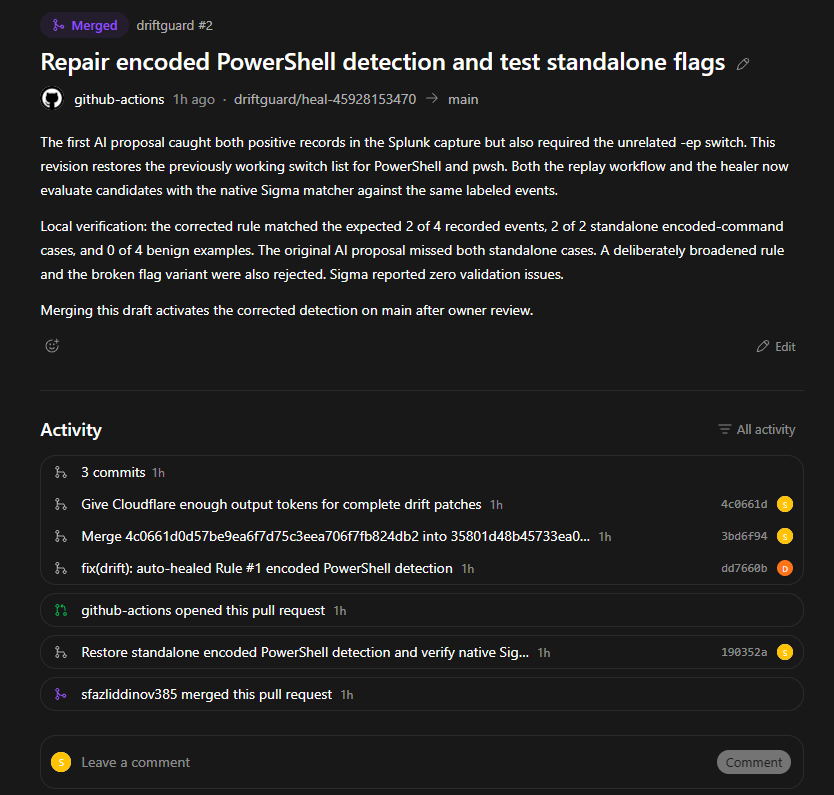

# DriftGuard

[](https://github.com/sfazliddinov385/DriftGuard/actions/workflows/replay-validation.yml)

**Does our alert rule still catch the right events after this edit?** DriftGuard helps a security team answer that question before it puts a rule into use.

When someone changes a rule on GitHub, DriftGuard runs it against saved Windows logs and checks exactly which events it finds. The team can see if the edit missed something suspicious or started flagging everyday activity. Splunk can run the approved rule against company logs. DriftGuard does its testing on the examples in this repository.

[See the latest test results](https://sfazliddinov385.github.io/DriftGuard/) · [View the checks on GitHub](https://github.com/sfazliddinov385/DriftGuard/actions/workflows/replay-validation.yml)

## What happened when we broke a rule

### 1. The rule looked valid but missed both events

We deliberately changed the PowerShell rule to look for a made-up flag, `-legacy_broken_flag`. The rule still passed the Sigma syntax check. Then DriftGuard replayed four recorded Windows events. **Two contained an encoded PowerShell command. The edited rule found zero.** The run stayed red to show that this version of the rule had failed. [Open the failed replay in run #7](https://github.com/sfazliddinov385/DriftGuard/actions/runs/45928153470/job/140274290861#step:6:1)


### 2. DriftGuard opened a repair for review

Cloudflare Workers AI suggested a change, and DriftGuard opened draft pull request #2. The suggestion caught both recorded examples. But both happened to include an extra flag, `-ep`, and the suggested rule required it. During review, two new examples showed that the rule would still miss encoded commands without that flag. We corrected the rule, kept both examples as tests, and merged the repair. [Read pull request #2](https://github.com/sfazliddinov385/DriftGuard/pull/2)



### 3. The same four events showed the fix worked

In a later run, the repaired PowerShell rule found **exactly the two expected events out of four**. It also caught both examples without `-ep` and left all four normal examples alone. All three rules passed their tests, so DriftGuard skipped the AI repair step. [Open the replay results in run #20](https://github.com/sfazliddinov385/DriftGuard/actions/runs/45934920471/job/140295805099#step:8:1)


## What the rules look for

The recordings come from Splunk Attack Data. They are XML logs from Sysmon, a Windows tool that records which programs started and how they were launched. The test lists the exact event IDs each rule should find. Catching the wrong two events would fail even if the count looked right. [See the expected event IDs and extra examples](tests/manifest.yml) · [Browse the source dataset](https://github.com/splunk/attack_data)

| Rule | What it looks for | Expected matches in the recording | MITRE ATT&CK |
| --- | --- | --- | --- |
| [Encoded PowerShell](rules/windows/proc_creation_encoded_powershell.yml) | PowerShell starts with a flag such as `-enc` that tells it to read an encoded command. | 2 of 4 | T1059.001 |
| [Suspicious scheduled task](rules/windows/proc_creation_schtasks_suspicious.yml) | A new Windows task points to a script runner, a web address, or a location such as a temporary folder. | 2 of 16 | T1053.005 |
| [Suspicious Mshta use](rules/windows/proc_creation_mshta_suspicious.yml) | The Windows program `mshta.exe` opens a web address, runs a script directly, or loads a file from a location the rule watches. | 6 of 10 | T1218.005 |

## How a rule change gets checked

1. On a push to `main` or a pull request targeting it, GitHub Actions checks the rule files and translates them into Splunk searches. It also runs tests for the repair code.
2. DriftGuard reads the saved events and compares each rule’s matches with the expected IDs. Each rule also has two extra examples it should catch and four examples of normal activity it should leave alone.
3. If a rule fails replay, the repair script can ask Cloudflare Workers AI for a change through AI Gateway. It sends selected log fields and masks details such as email addresses. It keeps the two extra examples out of the request and uses them to check the suggested fix.
4. The script checks the suggested rule’s field names and syntax, then repeats the replay. It allows up to three attempts. A passing suggestion goes into a draft pull request for a person to review. The original failed run stays red.

The dashboard shows the latest published check of `main`. Open a rule to see which recorded events it missed or flagged unexpectedly. You can also download those results as JSON. [Open the dashboard](https://sfazliddinov385.github.io/DriftGuard/) · [Get the JSON report](https://sfazliddinov385.github.io/DriftGuard/data.json) · [Read the workflow](.github/workflows/replay-validation.yml)

During development, an early Cloudflare reply stopped halfway through a rule. We gave it more room to finish and added a check that rejects an incomplete reply. [Read the change in PR #1](https://github.com/sfazliddinov385/DriftGuard/pull/1)

## Try it on your computer

Clone this repository, open the DriftGuard folder, and use Python 3.11. The replay runs locally using the files in the repository. You can run all four checks without a Splunk account or Cloudflare token.

**Windows PowerShell**

```powershell
python -m venv .venv
.\.venv\Scripts\python.exe -m pip install -r requirements.txt
.\.venv\Scripts\sigma.exe check --fail-on-issues rules/
.\.venv\Scripts\sigma.exe convert -t splunk -p splunk_windows rules/
.\.venv\Scripts\python.exe -m pytest -q
.\.venv\Scripts\python.exe scripts/run_replay_suite.py --json-out reports/replay.json
```

**macOS or Linux**

```bash
python3 -m venv .venv
source .venv/bin/activate
python -m pip install -r requirements.txt
sigma check --fail-on-issues rules/
sigma convert -t splunk -p splunk_windows rules/
python -m pytest -q
python scripts/run_replay_suite.py --json-out reports/replay.json
```

For the three rules shown above, the last line should read `Suite summary: 3/3 rules passed.` You can inspect your own results in `reports/replay.json`.

To enable draft repairs in your own GitHub repository, add the Actions secrets `CLOUDFLARE_ACCOUNT_ID`, `CLOUDFLARE_GATEWAY_ID`, and `CLOUDFLARE_API_TOKEN`. Under **Settings → Actions → General → Workflow permissions**, allow GitHub Actions to create pull requests.
