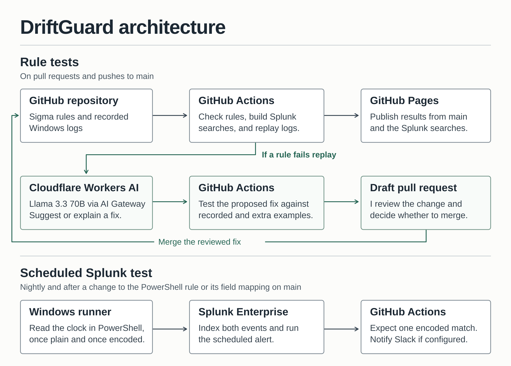
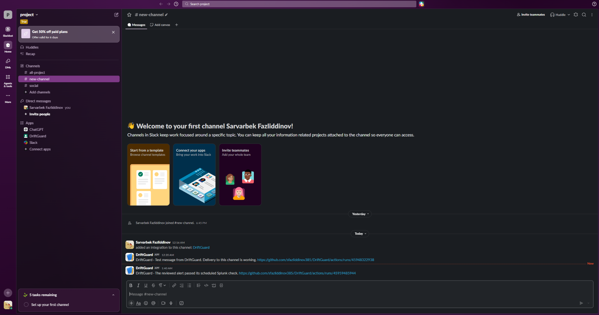
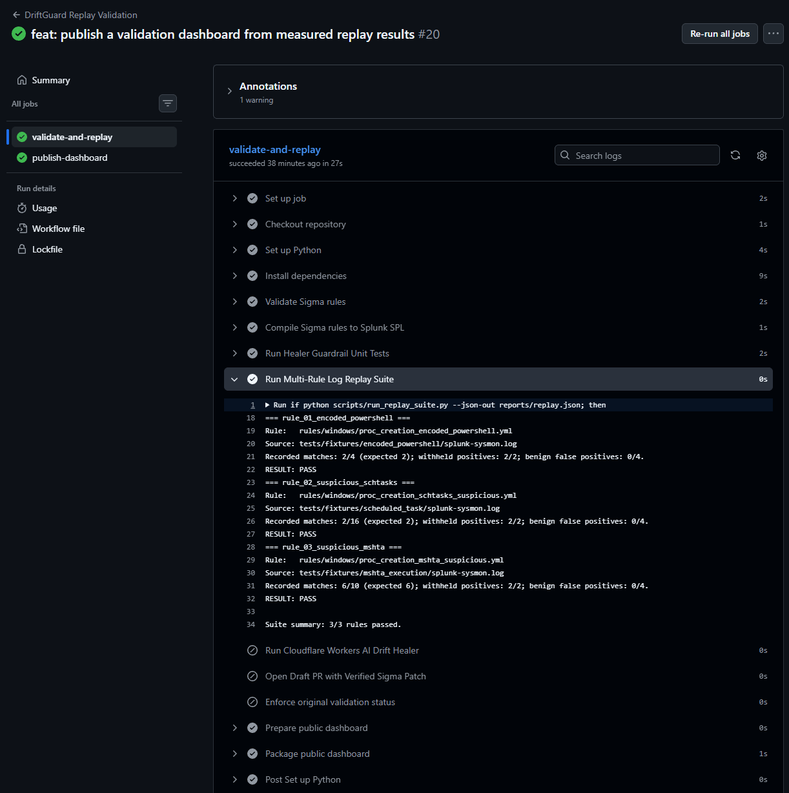

# DriftGuard

[](https://github.com/sfazliddinov385/DriftGuard/actions/workflows/replay-validation.yml)

I built DriftGuard to catch broken Windows alert rules. A rule can pass a syntax check and still miss the event I wrote it to catch. DriftGuard runs each Sigma rule against recorded Windows logs, checks the exact records it finds, and translates the rule into a Splunk search.

**I use Meta Llama 3.3 70B Instruct to help repair broken rules.** When a rule fails replay, DriftGuard sends its detection logic and a few sample events to the model through Cloudflare Workers AI and AI Gateway. The model can suggest a fix or explain why an earlier version worked. DriftGuard tests the fix before opening a draft pull request for me to review. Passing runs skip the model. [Repair code and model ID](scripts/ai_healer.py#L32) · [Draft with two tested repairs](https://github.com/sfazliddinov385/DriftGuard/pull/10)

[See the test results and Splunk searches](https://sfazliddinov385.github.io/DriftGuard/) · [Open the GitHub run](https://github.com/sfazliddinov385/DriftGuard/actions/runs/45968164072) · [View the MITRE ATT&CK map](https://mitre-attack.github.io/attack-navigator/#layerURL=https%3A%2F%2Fsfazliddinov385.github.io%2FDriftGuard%2Fattack-layer.json)

## How DriftGuard works



<a name="how-we-proved-the-original-alert-recovered"></a>

## How I caught a broken Splunk alert

I used PowerShell to read the clock twice on Windows. One command was plain text. The other was encoded. Both did the same harmless thing, but only the encoded command should trigger my rule. I changed the test log's command-line field from `CommandLine` to `OriginalCommandText`. Splunk received both events. Its scheduled alert missed the encoded one.

| Stage | Result |
| --- | --- |
| Before the fix | The original alert ran and returned zero matches. DriftGuard reported the missed Windows record, `1566191`. [Failed run](https://github.com/sfazliddinov385/DriftGuard/actions/runs/45948322930/job/140338174152) |
| During review | DriftGuard tested a separate Splunk search that could read either field name. It caught only `1566191`. DriftGuard opened a draft with the field change and the results. [Repair in PR #5](https://github.com/sfazliddinov385/DriftGuard/pull/5) |
| After merge | GitHub started a fresh Splunk Enterprise instance. At **1:39 a.m. Central on November 27, 2026**, the original scheduled alert fired on a new encoded clock read, `1565734`. The plain clock read, `1565732`, stayed quiet. [Post-merge run](https://github.com/sfazliddinov385/DriftGuard/actions/runs/45959485944/job/140373777332) |

DriftGuard found the same job ID in the results from the original search, `DriftGuard_Managed_PowerShell_Canary`, and in Splunk's fired-alert history. [Before-and-after job reports](docs/evidence/splunk-recovery.json)

## What DriftGuard sent to Slack

I connected DriftGuard to `#new-channel` in Slack. When a replay on `main` misses an expected event, DriftGuard can post a link to the failed check. It also sends the result of the scheduled Splunk test, so I can open the GitHub run from the channel.

The screenshot shows two messages from the DriftGuard app. The first confirmed delivery to the channel. The second arrived after the reviewed PowerShell alert passed its scheduled Splunk check. [Slack delivery test](https://github.com/sfazliddinov385/DriftGuard/actions/runs/45948322938) · [Scheduled Splunk check](https://github.com/sfazliddinov385/DriftGuard/actions/runs/45959485944)



To send alerts to your own channel, save its incoming webhook as the GitHub Actions secret `DRIFTGUARD_WEBHOOK_URL`. [Slack setup](docs/operations.md#slack-and-attck-coverage)

## Evidence from the same run

In a separate test, I kept the **same two Windows records** and changed only how Splunk read the command line. The alert caught record `1566141`, missed it when the field name changed, and caught it again when I restored the mapping. [Dashboard results](https://sfazliddinov385.github.io/DriftGuard/#scheduled-alert-demo) · [Full run](https://github.com/sfazliddinov385/DriftGuard/actions/runs/45944956740)


1. **Windows recorded both commands.** The capture job collected two process-start events from the Windows Security log, both event type 4688. [Windows capture log](https://github.com/sfazliddinov385/DriftGuard/actions/runs/45944956740/job/140327420538#step:3:5)

   

2. **GitHub started Splunk Enterprise.** The job pulled the official `splunk/splunk` image. The startup log identifies version 10.2.10. [Splunk startup log](https://github.com/sfazliddinov385/DriftGuard/actions/runs/45944956740/job/140327513619#step:6:66)

   

3. **Splunk ran all three searches.** Both events reached Splunk each time. The scheduler recorded one alert with the original field, zero with the renamed field, and one after the fix. [Scheduler results, lines 165–171](https://github.com/sfazliddinov385/DriftGuard/actions/runs/45944956740/job/140327513619#step:6:165)

   

## What the three rules caught

I used Sysmon XML recordings from Splunk Attack Data. The tests compare Windows record IDs, so finding the right number of events but the wrong records fails the run. [Source recordings](https://github.com/splunk/attack_data) · [Expected record IDs and test cases](tests/manifest.yml)

| Rule | What it looks for | Expected records found | MITRE ATT&CK |
| --- | --- | --- | --- |
| [Encoded PowerShell](rules/windows/proc_creation_encoded_powershell.yml) | PowerShell starts with an encoded-command flag such as `-enc`. | 2 of 4 | T1059.001 |
| [Suspicious scheduled task](rules/windows/proc_creation_schtasks_suspicious.yml) | A command creates a Windows task that points to a script runner, a web address, or a folder such as `Temp`. | 2 of 16 | T1053.005 |
| [Suspicious Mshta use](rules/windows/proc_creation_mshta_suspicious.yml) | `mshta.exe` starts with a web address, inline script, or path such as `AppData`. | 6 of 10 | T1218.005 |

The rules found all **10 expected records** and all **6 extra examples** I kept out of the repair prompt. They flagged **0 of 12** examples of normal activity. They also flagged **0 of 91** process starts from one Windows computer in the DARPA OpTC dataset. That sample includes scheduled tasks, Defender, Group Policy, and PowerShell. It contains no encoded PowerShell or Mshta examples. [Sample and selection criteria](tests/baselines/README.md)

I also ran eight ordinary Windows tasks. **One triggered the PowerShell rule** because it used an encoded command to read the clock. That alert shows why an analyst still needs to check what the command did. [Eight-task Windows test](https://github.com/sfazliddinov385/DriftGuard/actions/runs/45940187569/job/140312486418#step:6:1)

## What happened when I broke the PowerShell rule

1. **The rule passed syntax checks and missed both records.** I replaced the real PowerShell flags with the made-up flag `-legacy_broken_flag`. GitHub accepted the Sigma syntax. The replay found zero of the two expected records. [Failed replay](https://github.com/sfazliddinov385/DriftGuard/actions/runs/45928153470/job/140274290861#step:6:1)

   

2. **The first fix missed encoded commands without `-ep`.** Cloudflare Workers AI suggested a rule that required `-ep`. Both recorded commands included it. I added two examples without that flag and the suggested rule missed both. I corrected the rule and kept those examples as tests. [Reviewed fix in PR #2](https://github.com/sfazliddinov385/DriftGuard/pull/2)

   

3. **The corrected rule passed both sets of tests.** It found the two expected records, caught both examples without `-ep`, and skipped all four normal examples. All three rules passed, so DriftGuard skipped Cloudflare. [Passing replay](https://github.com/sfazliddinov385/DriftGuard/actions/runs/45934920471/job/140295805099#step:8:1)

   

## How GitHub checks a change

On a pull request targeting `main` or a push to `main`, GitHub Actions checks the Sigma syntax, compiles every rule into Splunk SPL, and runs the automated tests. DriftGuard then replays each rule against its recording. A missing test entry, a missed record, or an unexpected match fails the check. I tested the merge requirement with a valid Sigma rule that Splunk could not translate. GitHub blocked the merge. [Workflow](.github/workflows/replay-validation.yml) · [Failed compilation](https://github.com/sfazliddinov385/DriftGuard/actions/runs/45964376326/job/140389428722) · [Correction in PR #7](https://github.com/sfazliddinov385/DriftGuard/pull/7)

When a rule fails replay, DriftGuard sends its detection logic and selected log fields to Cloudflare Workers AI through AI Gateway. It masks IP addresses, emails, account names it recognizes, and GUIDs before sending each request. Rule metadata and the extra test cases stay on the GitHub runner. An early reply cut off halfway through a rule, so I added a check that rejects incomplete replies. [Change in PR #1](https://github.com/sfazliddinov385/DriftGuard/pull/1)

DriftGuard allows up to three repair attempts per rule. It checks proposed changes against the allowed fields, Sigma syntax, and test events. If a suggestion fails, DriftGuard can use an earlier version from Git that passes the same tests and ask Cloudflare to explain the change. Before opening a draft, it compiles the repaired rules and reruns the unit tests and all three replays. The draft names who selected the fix and targets the branch that failed. I decide whether to merge. The original failed run stays red.

I tested this by breaking the PowerShell and scheduled-task rules together. Cloudflare's first PowerShell suggestion flagged two normal examples, so DriftGuard rejected it. DriftGuard selected the earlier PowerShell rule and Cloudflare explained the fix. Cloudflare selected the earlier scheduled-task rule. All **72 automated tests** and all three replays passed on the repairs. DriftGuard opened one draft for both. [Two-rule test](https://github.com/sfazliddinov385/DriftGuard/actions/runs/45967628395/job/140400023832) · [Draft PR #10](https://github.com/sfazliddinov385/DriftGuard/pull/10)

The dashboard shows the latest published check of `main`. Open a rule to see its Splunk search and the record IDs it caught, missed, or flagged unexpectedly. [Dashboard](https://sfazliddinov385.github.io/DriftGuard/) · [JSON results](https://sfazliddinov385.github.io/DriftGuard/status.json)

## Run the tests locally

Clone this repository and open its folder. The replay uses Python 3.11 and the included logs. You can run it without Splunk or a Cloudflare account.

**Windows PowerShell**

```powershell
python -m venv .venv
.\.venv\Scripts\python.exe -m pip install -r requirements.txt
.\.venv\Scripts\sigma.exe check --fail-on-issues rules/
.\.venv\Scripts\sigma.exe convert -t splunk -p splunk_windows rules/
.\.venv\Scripts\python.exe -m pytest -q
.\.venv\Scripts\python.exe scripts/run_replay_suite.py --json-out reports/replay.json
.\.venv\Scripts\python.exe scripts/check_benign_baseline.py --input tests/baselines/windows-processes.json --json-out reports/benign-baseline.json
```

**macOS or Linux**

```bash
python3 -m venv .venv
source .venv/bin/activate
python -m pip install -r requirements.txt
sigma check --fail-on-issues rules/
sigma convert -t splunk -p splunk_windows rules/
python -m pytest -q
python scripts/run_replay_suite.py --json-out reports/replay.json
python scripts/check_benign_baseline.py --input tests/baselines/windows-processes.json --json-out reports/benign-baseline.json
```

The replay prints `Suite summary: 3/3 rules passed.` The last command prints how many of the 91 normal process starts matched. Both commands save their results in `reports/`.

To enable draft repairs in a fork, add the GitHub Actions secrets `CLOUDFLARE_ACCOUNT_ID`, `CLOUDFLARE_GATEWAY_ID`, and `CLOUDFLARE_API_TOKEN`. Under **Settings → Actions → General → Workflow permissions**, allow GitHub Actions to create pull requests. To require a passing check before merge, import this repository's ruleset under **Settings → Rules → Rulesets**. [GitHub ruleset](config/main-ruleset.json)

## Run a check in Splunk

I tested the four recorded PowerShell events in Splunk Enterprise 10.2.10. Splunk found both expected IDs. When I moved the command line to another field, all four events still arrived, but the search returned zero. DriftGuard named the missing field and both missed IDs. [Splunk job](https://github.com/sfazliddinov385/DriftGuard/actions/runs/45941550323/job/140316779935#step:5:1) · [Saved results](docs/evidence/splunk-replay.json)

- **Try the scheduled alert on GitHub.** The test starts a temporary Splunk instance, records two fresh Windows events, and waits for Splunk to run the alert. [Hosted Splunk test](docs/splunk-integration.md)
- **Test a search on your own Splunk.** Load the four recorded events into a test index, run the search, and compare the record IDs. [Splunk replay instructions](docs/splunk-replay.md)
- **Check recent logs on your own Splunk.** The read-only check reports when Sysmon last sent data and how many events contain the image path and command line. Your local results stay on your computer. [Sysmon health check](docs/splunk-health.md)
- **Run the check overnight or send a Slack alert.** The setup guide covers the GitHub schedule, the optional Windows task, and where Slack sends the results. [Setup instructions](docs/operations.md)
